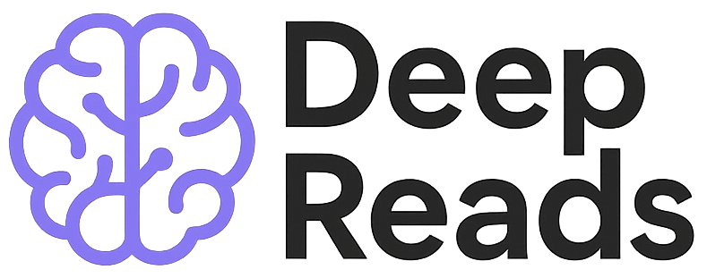

# Deep Reads

Optional articles connect course ideas to research and broader questions. Start with [Language in Brains, Minds, and Machines](./lang_bmm.html), or return to [Resources](../resources.html) for shorter references.
