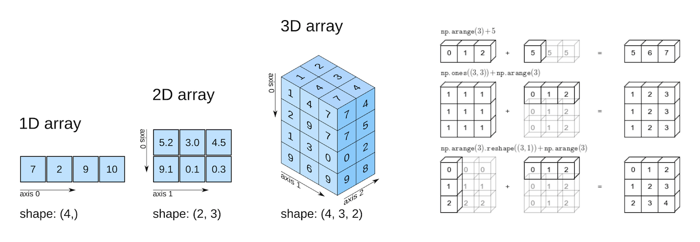
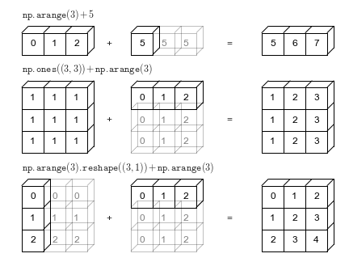

# NumPy and Your First Graph

NumPy gives Python a simple way to store and transform columns of numbers—the basic shape of many machine-learning datasets.

**Suggested week:** 1 · **Time:** 60–90 minutes · **Prerequisites:** basic Python variables and functions

## What you will learn

- Create an array and inspect its shape.
- Select values with indexing and boolean masks.
- Make a graph and change the underlying data.

## Core Path

Use [Google Colab](https://colab.research.google.com) for this lesson. A notebook keeps code, output, and explanation together, so you can experiment without configuring a local environment.

### Create and inspect an array

An array stores values in a regular structure. Unlike a Python list, it supports concise numerical operations across every value.

```python
import numpy as np

scores = np.array([52, 57, 63, 68, 74, 79])

print(scores.shape)  # six values
print(scores.mean())
print(scores * 1.05)  # apply the operation to every value
```

For a two-dimensional array, `shape` reports rows followed by columns:

```python
data = np.array([
    [1, 52],
    [2, 57],
    [3, 63],
])

print(data.shape)  # (3, 2)
```



### Select values

Python indexing starts at zero. A slice selects a range; a boolean mask keeps values that satisfy a condition.

```python
print(scores[0])       # first value
print(scores[1:4])     # positions 1, 2, and 3
print(scores[scores >= 65])
```

The expression `scores >= 65` creates `True` or `False` for every value. Passing that mask back into the array returns only matching values.

### Week 1 activity: your first graph

Use two arrays to make a visible result:

```python
import numpy as np
import matplotlib.pyplot as plt

hours = np.array([1, 2, 3, 4, 5, 6])
scores = np.array([52, 57, 63, 68, 74, 79])

plt.plot(hours, scores, marker="o")
plt.xlabel("Hours practiced")
plt.ylabel("Score")
plt.title("A first look at a small dataset")
plt.show()
```

Change one value, run the cell again, and write:

1. Two things you notice.
2. One question the graph cannot answer.

A graph can reveal a pattern, but it does not prove that one variable caused the other.

For the guided version, [open the Week 1 notebook in Colab](https://colab.research.google.com/github/astarryknight/ai-ml/blob/main/notebooks/week-01-array-explorer.ipynb) or [download it](../../notebooks/week-01-array-explorer.ipynb).

## Try it

Write code that:

1. Creates an array containing the numbers 1 through 10.
2. Reshapes it to `(2, 5)` and prints the shape.
3. Multiplies every value by 5.
4. Prints the values greater than 25.
5. Prints the index of the largest value.

<details>
<summary>One possible answer</summary>

```python
a = np.arange(1, 11).reshape(2, 5)
b = a * 5

print(a.shape)
print(b[b > 25])
print(np.argmax(b))
```

</details>

## Quick self-check

1. What does an array shape of `(4, 3)` mean?
2. What does `values[values < 0]` return?
3. Why is changing one value and rerunning the graph useful?

Use [Knowledge Checks](../assessments/checkpoints.html) for answer guidance.

## Optional Depth

You do not need the rest of this page to finish Week 1. Return when later lessons require a particular operation.

### Axes and aggregation

For a 2D array, `axis=0` combines values down the rows and returns one result per column. `axis=1` combines across the columns and returns one result per row.

```python
data = np.array([
    [2, 5, 7],
    [3, 6, 8],
])

print(data.mean(axis=0))
print(data.sum(axis=1))
```

Useful inspection and aggregation methods include `ndim`, `shape`, `dtype`, `size`, `min`, `max`, `mean`, `sum`, `argmin`, and `argmax`.

### Data types and higher dimensions

NumPy chooses a data type for an array, or you can request one explicitly:

```python
measurements = np.array([1, 2, 3], dtype="float32")
print(measurements.dtype)
```

Arrays can have three or more dimensions, but the core lessons mostly use one-dimensional columns and two-dimensional tables.

```python
images = np.zeros((10, 28, 28))
print(images.shape)  # 10 images, each 28 by 28 pixels
```

### Vectorized arithmetic

Operations such as `+`, `-`, `*`, and `/` usually apply element by element:

```python
a = np.array([1, 2, 3])
b = np.array([10, 20, 30])

print(a + b)
print(a * 2)
```

### Broadcasting

Broadcasting lets NumPy combine arrays with compatible shapes without manually copying values. Here, one three-value row is subtracted from every row in the table:

```python
data = np.array([
    [2, 5, 7],
    [3, 6, 8],
])

column_means = data.mean(axis=0)
centered = data - column_means
```



### Useful constructors and reshaping

```python
zeros = np.zeros((2, 3))
ones = np.ones((2, 3))
evenly_spaced = np.linspace(0, 1, 5)
random_integers = np.random.randint(0, 21, size=10)
reshaped = np.arange(12).reshape(3, 4)
```

## Next step

Continue to [Intro to Machine Learning](../theory/intro_ml.html) to see how arrays become features, targets, and model inputs.
