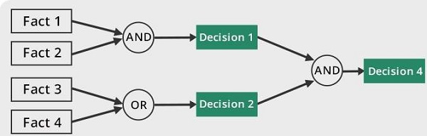

# What is AI/ML?

AI and machine learning are broad labels, but the basic distinction is simple: AI describes the goal, while machine learning is one way to reach it.

**Suggested week:** 1 · **Time:** 30–45 minutes · **Prerequisites:** none

## What you will learn

- Define AI and machine learning in plain language.
- Compare rule-based and data-driven approaches.
- Recognize regression, classification, and clustering problems.

## Core Path

[Artificial intelligence](../glossary.html#artificial-intelligence) is the broad field of building systems that perform tasks associated with intelligent behavior. [Machine learning](../glossary.html#machine-learning) is an approach within AI where systems learn useful patterns from examples instead of relying only on hand-written rules.

This course focuses mainly on machine learning. You do not need advanced math or a large amount of code to understand its central idea: show a system examples, measure how useful its output is, and improve it.

### Two ways to build intelligent behavior

**Rule-based systems** follow explicit instructions written by a person. They work well when the rules are clear, stable, and easy to list. A tax-form validator might check, “If this field is empty, show an error.”

**Data-driven systems** learn patterns from examples. They are useful when the rules would be hard to write by hand, such as deciding whether an email is spam from thousands of earlier messages.

Neither approach is always better. Many useful systems combine clear rules with learned models.

### Three common ML problem types

- [**Regression**](../glossary.html#regression) predicts a number, such as delivery time or price.
- [**Classification**](../glossary.html#classification) predicts a category, such as spam or not spam.
- [**Clustering**](../glossary.html#clustering) groups similar examples when the desired groups are not already labeled.

### Why data matters

A model learns from the examples it receives. Incomplete, biased, or incorrect examples can produce unreliable behavior even when the code runs perfectly. Representative data and honest evaluation matter as much as the choice of model.

## Try it: name the task

For each idea, choose regression, classification, or clustering:

1. Predict tomorrow's temperature.
2. Decide whether a review is positive or negative.
3. Group songs by similar audio characteristics without named genres.

Check your answer

1. Regression, because the output is a number.
2. Classification, because the output is a category.
3. Clustering, because the groups are discovered without provided labels.

## Quick self-check

1. What is the difference between AI and machine learning?
2. When would an explicit rule be easier to trust than a learned pattern?
3. Why can two models with identical code behave differently when trained on different data?

For answer guidance, use [Knowledge Checks](../assessments/checkpoints.html).

## Optional Depth

The term **symbolic AI** refers to systems that represent knowledge with explicit symbols and rules. **Connectionist** approaches use networks of simple connected units; modern neural networks belong to this tradition. These labels are useful context, but they are not required for the core course.

## Next step

Continue to [NumPy and Your First Graph](./numpy.html) to represent small datasets and make a visible result with code.
