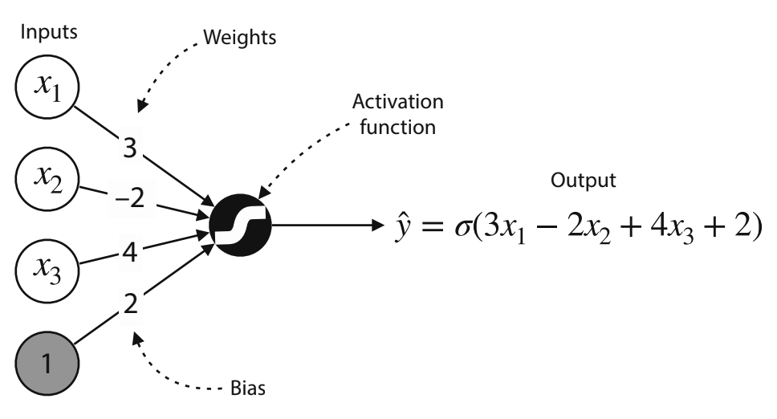
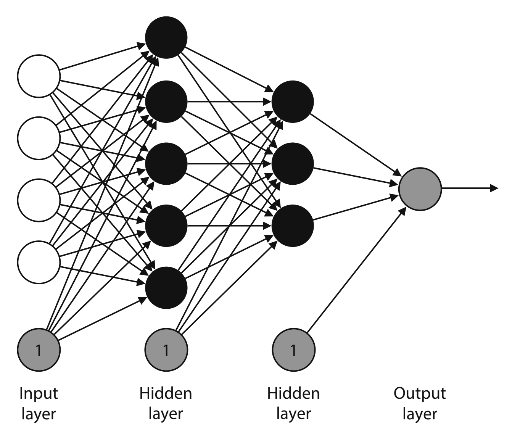
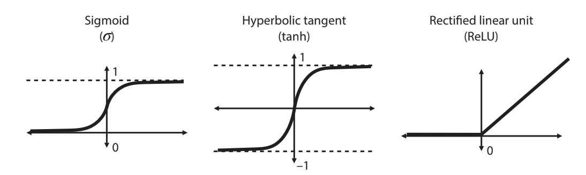

# Artificial Neural Networks

[Neural networks](../glossary.html#neural-network) learn combinations of input features that help make a prediction. A handwritten-digit classifier makes each part concrete: pixels become inputs, hidden layers combine visual evidence, and the output represents the model's guess.

**Suggested week:** 6 · **Time:** 90–120 minutes · **Prerequisites:** Intro to Machine Learning and Optimization

## What you will learn

- Explain how inputs, weights, a bias, and an activation produce an output.
- Trace an image through the input, hidden, and output layers.
- Describe training and backpropagation without calculating derivatives by hand.
- Use a confusion matrix and misclassified images to evaluate a model.

## Core Path

Prioritize these ideas on a first pass:

1. An image can be represented as numbers.
2. One neuron computes a weighted combination of its inputs.
3. Hidden layers learn useful combinations of simple signals.
4. Training adjusts weights to reduce prediction error.
5. Evaluation must use images the model did not train on.

---

## Running example: recognizing handwritten digits

Suppose we want a model to recognize handwritten digits from `0` through `9`. We will use scikit-learn's built-in digits dataset. It contains small 8×8 grayscale images, so every image has 64 pixels.

Each pixel is a number from `0` to `16`:

- `0` means the pixel is dark.
- Larger values mean the pixel is brighter.
- The label is the digit shown in the image.

One image therefore becomes a row of 64 input features:

```text
8 × 8 image → 64 pixel values → model → predicted digit
```

This is the same supervised-learning workflow used earlier in the course. The data type changed, but the roles did not:

| Course idea | Digit example |
| --- | --- |
| Sample | One handwritten image |
| Features | The 64 pixel brightness values |
| Target | The correct digit, 0 through 9 |
| Prediction | The digit selected by the model |
| Error analysis | Looking at images the model confused |

The example remains useful beyond this lesson. Larger image models still begin with numeric pixel values, learn internal representations, and produce predictions that must be evaluated.

---

## One neuron: combine evidence

A neuron receives numbers, multiplies them by learned weights, adds a bias, and applies an [activation function](../glossary.html#activation-function).

$$
z = w_1x_1 + w_2x_2 + \dots + w_nx_n + b
$$

$$
\text{output} = f(z)
$$



For a digit image:

- Each $x_i$ is a pixel value.
- Each $w_i$ controls how strongly that pixel influences the neuron.
- The bias $b$ shifts when the neuron becomes active.
- The activation $f$ lets the network represent nonlinear patterns.

It is tempting to give every hidden neuron a human label such as "top loop detector." Sometimes a learned unit responds to a recognizable pattern, but hidden features are not guaranteed to have a simple human interpretation. The safer idea is that each unit learns a useful combination of pixels.

### A tiny calculation

Imagine a simplified neuron that looks at only three pixels:

```text
pixel values:  [0.9, 0.2, 0.8]
weights:       [1.0, -0.5, 0.7]
bias:          -0.4
```

Its score is:

$$
(0.9)(1.0) + (0.2)(-0.5) + (0.8)(0.7) - 0.4 = 0.96
$$

The activation function transforms that score before passing it to the next layer. Training determines the useful weights; we do not choose them by hand.

---

## Layers build a prediction

A small digit network might have:

```text
64 inputs → 32 hidden units → 10 output scores
```



### Input layer

The input layer receives the 64 normalized pixel values. It does not make a decision by itself.

### Hidden layer

Every hidden unit computes a different weighted combination of the pixels. Together, the hidden units can represent patterns that a single linear classifier may not capture well.

### Output layer

The network produces one score for each possible digit. A softmax operation converts the ten scores into values that sum to `1`. The largest value determines the predicted class.

For example:

```text
digit:        0    1    2    3    4    5    6    7    8    9
probability: .01  .00  .02  .04  .01  .78  .02  .03  .08  .01
```

The model predicts `5`, but the full set of probabilities also shows its uncertainty.

---

## Why activation functions matter

Without nonlinear activations, stacking several linear layers would still behave like one linear transformation. Activations allow layers to build more flexible representations.

For this lesson, remember two:

- **ReLU:** returns `0` for a negative input and returns the input itself when it is positive. It is common in hidden layers.
- **Softmax:** converts the final class scores into a distribution across the ten digits.

The practice activity uses ReLU inside the network. scikit-learn handles the output calculation for multiclass classification.

---

## A forward pass

A [prediction](../glossary.html#prediction-inference) moves from left to right:

1. Normalize the 64 pixel values.
2. Multiply inputs by the first layer's weights and add biases.
3. Apply ReLU to produce hidden values.
4. Combine the hidden values into ten output scores.
5. Convert the scores into class probabilities.
6. Choose the digit with the highest probability.

This process is called a **forward pass**. It is used during both training and inference.

---

## How the network learns {#backpropagation}

At first, the weights are not useful. Training repeats a short loop:

1. **Predict:** run a batch of images through the network.
2. **Measure error:** compare the predictions with the correct labels using a loss function.
3. **Assign responsibility:** use [backpropagation](../glossary.html#backpropagation) to calculate how each weight contributed to the loss.
4. **Update:** use gradient descent or an optimizer such as Adam to adjust the weights.
5. **Repeat:** continue until validation performance stops improving or another stopping rule is reached.

Backpropagation does not train the model by itself. It supplies gradients. The optimizer uses those gradients to update the parameters.

### What changes during training?

- **Learned parameters:** weights and biases.
- **Chosen hyperparameters:** hidden-layer size, learning rate, regularization strength, batch size, and training limit.
- **Unchanged evidence:** the held-out test set, which is used only for final evaluation.

---

## Evaluation: inspect the mistakes

Accuracy is a useful summary, but it does not explain which digits are being confused.

A confusion matrix answers questions such as:

- Does the model often confuse `3` with `8`?
- Is one digit much harder than the others?
- Are most errors reasonable on ambiguous handwriting?

The images behind those errors matter too. Looking at misclassified examples can reveal faint strokes, unusual writing styles, preprocessing problems, or genuine ambiguity.

This habit transfers directly to later projects: do not stop at one metric. Inspect representative errors.

---

## Overfitting

A flexible network can memorize details of its training images instead of learning patterns that generalize. Signs include training performance improving while validation performance stalls or gets worse.

Common responses include:

- Use a separate validation set or early stopping.
- Reduce the number of hidden units or layers.
- Add L2 regularization.
- Collect more representative data.
- Inspect whether train and test data come from the same process.

Dropout is another option in larger neural-network libraries. It randomly disables some hidden units during training, which can reduce reliance on any single path through the network.

---

## Small activity

Choose one handwritten digit and answer:

1. Which parts of the image would help a person recognize it?
2. Which other digit might be confused with it?
3. Why would inspecting only accuracy hide that confusion?

Then sketch this architecture and label each part:

```text
64 pixel inputs → 32 ReLU hidden units → 10 digit outputs
```

## Quick self-check

1. Why does an 8×8 image become 64 input features?
2. What does a hidden unit do with its inputs?
3. Why is a nonlinear activation needed between layers?
4. What information does backpropagation provide to the optimizer?
5. What can a confusion matrix show that accuracy cannot?

Use [Knowledge Checks](../assessments/checkpoints.html) for answer guidance.

## Optional Depth

These ideas are useful after the core path is clear.

### Activation functions {#activation-functions}

Sigmoid and tanh can saturate at very positive or negative inputs, producing small gradients. ReLU is computationally simple and often keeps useful gradients for positive inputs. No activation is universally best; the task, architecture, and output type matter.



### Regularization

L2 regularization adds a penalty for large weights to the loss. In scikit-learn's `MLPClassifier`, the `alpha` parameter controls this penalty. Regularization can help, but it does not replace a representative validation strategy.

### Architecture and hyperparameters

Important choices include:

- Number of hidden layers.
- Number of units in each hidden layer.
- Activation function.
- Learning rate and optimizer.
- Batch size and training duration.
- Regularization strength.

Start with a small network and a baseline. Add complexity only when evaluation evidence supports it.

### What comes after a fully connected network?

Flattening an image into 64 independent features discards the explicit two-dimensional layout. Convolutional neural networks preserve more spatial structure and are often better suited to larger image tasks. The input, training, and evaluation ideas from this lesson still apply.

## References

- [scikit-learn digits dataset](https://scikit-learn.org/stable/modules/generated/sklearn.datasets.load_digits.html)
- [scikit-learn MLPClassifier](https://scikit-learn.org/stable/modules/generated/sklearn.neural_network.MLPClassifier.html)
- [scikit-learn ConfusionMatrixDisplay](https://scikit-learn.org/stable/modules/generated/sklearn.metrics.ConfusionMatrixDisplay.html)

## Next step

Train and inspect the [Handwritten Digit Classifier](../minis/ann.html).
