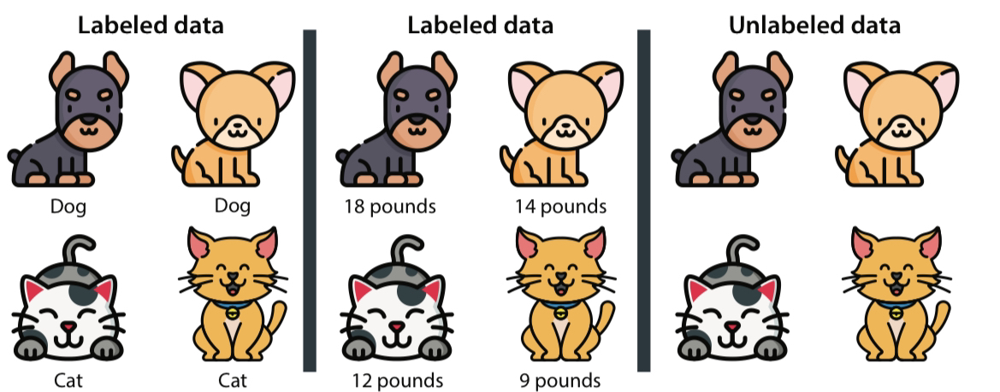
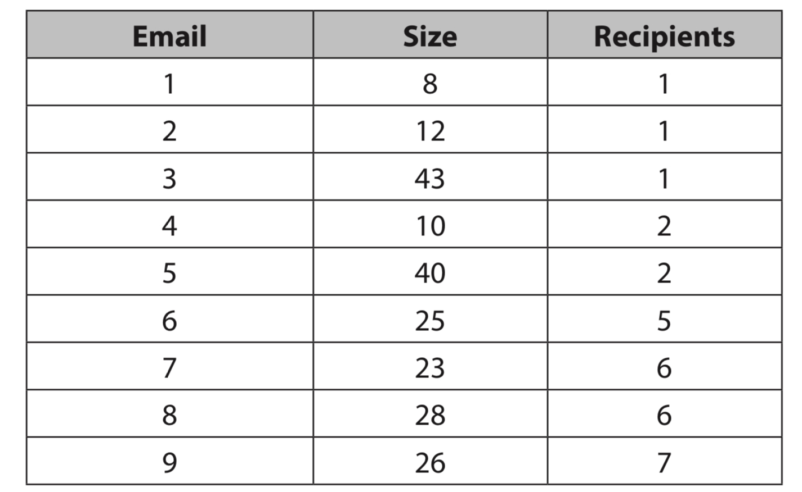
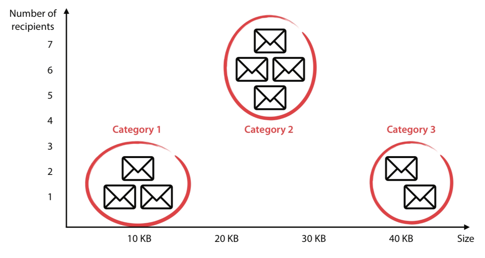
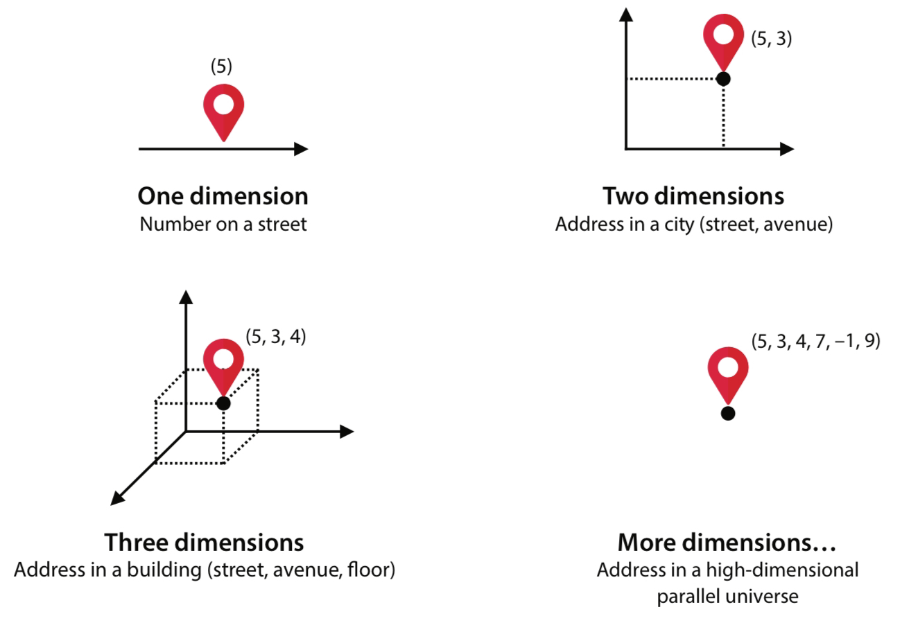

# Intro to Machine Learning

Machine learning becomes easier to reason about when you see it as a repeatable workflow rather than a collection of mysterious algorithms.

**Suggested week:** 2 · **Time:** 60–90 minutes · **Prerequisites:** [What is AI/ML?](../intro/whatisai.html) and basic NumPy

## What you will learn

- Identify features, targets, and labeled or unlabeled data.
- Describe the practical workflow from a baseline to an evaluated model.
- Choose between supervised learning and unsupervised learning.

## Core Path

### Features, targets, and labels {#features-targets-and-labels}

A [dataset](../glossary.html#dataset-sample) contains examples. The input properties a model can use are [features](../glossary.html#feature). In a song dataset, tempo, energy, and danceability might be features.

The answer a supervised model tries to predict is the [target or label](../glossary.html#target-label). If the goal is to predict whether someone likes a song, “liked” is the target. The same table can support different tasks depending on which column, if any, you choose as the target.

### The workflow loop {#the-workflow-loop}

Most projects use the same five-step loop:

1. **Inspect the data.** Understand each row, feature, target, and obvious quality problem.
2. **Split the data.** Keep some examples separate so evaluation reflects new data.
3. **Train a baseline.** Start with a simple reference result before adding complexity.
4. **Evaluate.** Use a metric that matches the real cost of mistakes.
5. **Iterate one change at a time.** Improve the data representation, model, or settings and compare again.

A [model](../glossary.html#model) is the learned representation that turns inputs into outputs. A training [algorithm](../glossary.html#algorithm) is the procedure used to construct or update that model. Using a trained model to make a new [prediction](../glossary.html#prediction-inference) is often called inference.

### Supervised learning {#supervised-learning}

[Supervised learning](../glossary.html#supervised-learning) uses examples that include the desired answer. It is a good fit when you can state what should be predicted and have trustworthy historical labels.

- Predicting a number is **regression**.
- Predicting a category is **classification**.

The [foundations lesson](../intro/whatisai.html#three-common-ml-problem-types) owns the full beginner explanation of those problem types. Here, the important workflow detail is that both require a target and a way to evaluate predictions on held-out examples.

### Unsupervised learning {#unsupervised-learning}

[Unsupervised learning](../glossary.html#unsupervised-learning) looks for structure without a provided target. It can reveal useful patterns, but it does not automatically tell you what those patterns mean.

### Clustering {#clustering}

[Clustering](../glossary.html#clustering) groups examples according to similarity. K-means, hierarchical clustering, and DBSCAN use different definitions of a useful group.

Imagine grouping songs using tempo, energy, and danceability. The algorithm can place similar songs together, but a person still has to inspect the groups before calling one “workout music” or another “quiet study music.” A cluster is evidence of similarity, not a discovered truth.

## Try it: frame a small ML task

Choose an everyday prediction or grouping idea and write four lines:

1. **User:** Who would use the result?
2. **Output:** What number, category, or grouping would help them?
3. **Inputs:** What two or three features could be available?
4. **Evidence:** How would you decide whether the result is useful?

Example: “A student wants a study-playlist group. Use tempo, energy, and instrumentalness. Inspect several songs from each cluster and ask whether the groups feel coherent.”

## Quick self-check

1. In a house-price model, which values are features and which value is the target?
2. Why should a baseline be created before trying a more complicated model?
3. Why does a cluster need human interpretation?

Use [Knowledge Checks](../assessments/checkpoints.html) for answer guidance.

## Optional Depth

### Dimensionality reduction

Dimensionality reduction represents data with fewer features while trying to preserve useful structure. It can support visualization, compression, or later modeling, but it can also discard information.

### Other learning families

[Reinforcement learning](./rl.html) learns from actions and rewards rather than a fixed answer for every example. Deep learning uses [neural networks](./ann.html); it is a model family, not a replacement for the workflow above.

## Common pitfalls

- Training and evaluating on the same examples.
- Choosing a metric that does not match the real task.
- Treating a cluster as a meaningful category without inspection.
- Changing many things at once, which makes improvements hard to explain.

## Next step

Continue to [Optimization & Gradient Descent](./grad_desc.html) to see how a model improves, or [Evaluation Basics](./evaluation.html) to learn how to judge its results.
