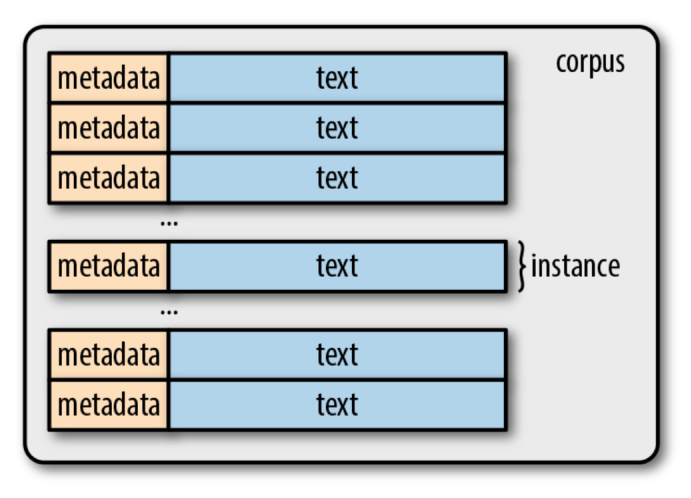
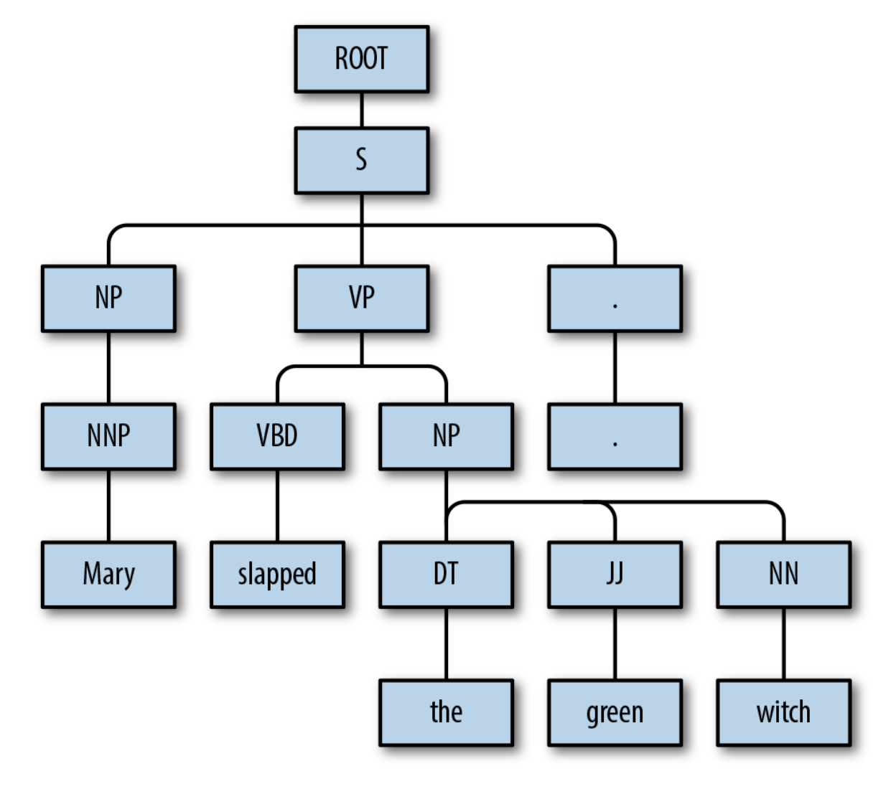
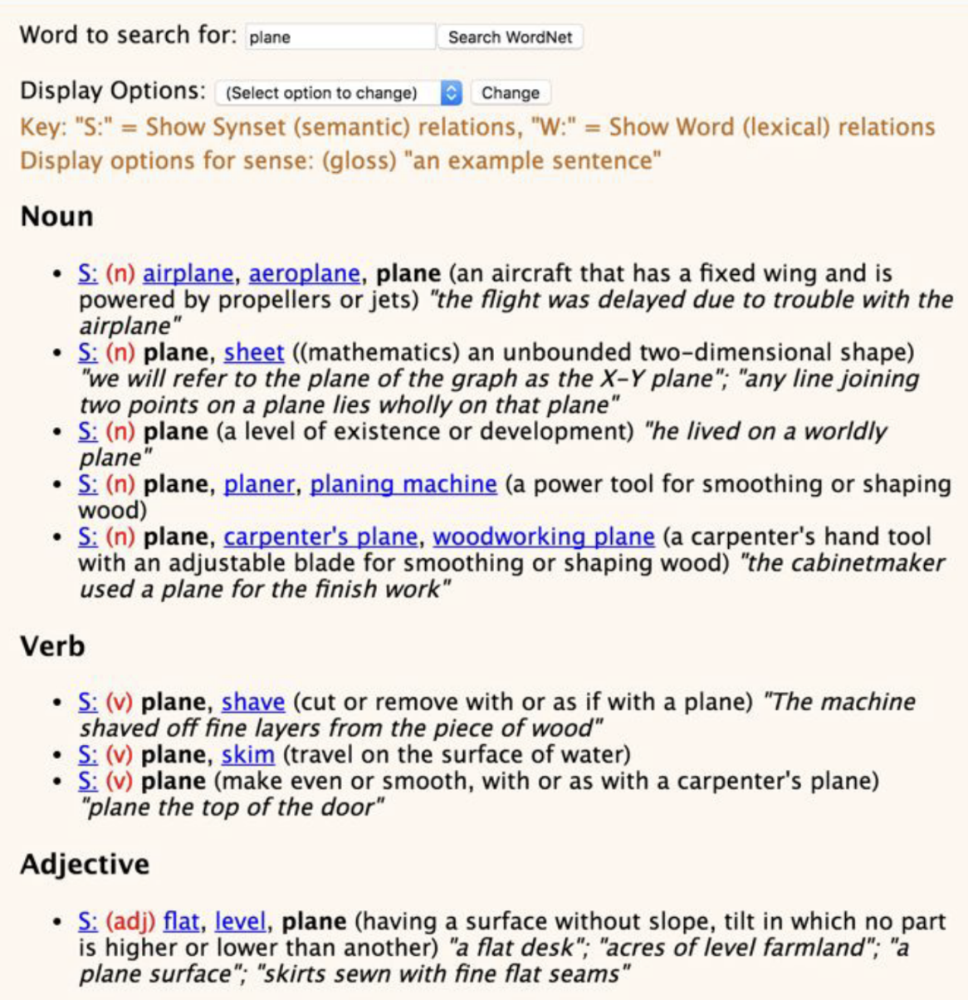

# Natural Language Processing

Natural language processing (NLP) gives computers ways to represent and work with human language.

**Suggested week:** 7, optional path · **Time:** 60–90 minutes · **Prerequisites:** Intro to Machine Learning

## What you will learn

- Explain corpora, tokens, vocabularies, and n-grams.
- Show how raw text becomes model features.
- Recognize preprocessing choices that can change meaning.

NLP supports search, classification, transcription, translation, assistants, and text generation. A system does not need to think like a human to perform a useful language task.

## Core Path

Prioritize these ideas on a first pass:

1. Tokenization and vocabulary basics.
2. Why normalization (lemmatization/stopword handling) matters.
3. How text becomes features for ML models.

### Corpora and tokens

A [corpus](../glossary.html#corpus-token) is a collection of text and related metadata used for an NLP task. One text and its metadata form an example.

A [token](../glossary.html#corpus-token) is one unit produced when text is split for processing. A simple English tokenizer might treat words and punctuation as tokens, but real tokenization varies across languages and model families.

**Tokenization** is the process of creating those units.
- "the quick brown fox jumps over the lazy dog" has 9 tokens.
- A different tokenizer may split the same sentence differently.



**Types** - unique tokens in a corpus

**Vocabulary**(lexicon) - the set of all types in a corpus

**Content Words** - words that typically have significant meaning over stop words

**Stop Words** - "filler" words between content words, like articles, prepositions or really any other word that serves a mostly grammatical purpose

----

### N-Grams
**N-grams** - fixed length (n) consecutive token sequences occuring in text.

Bigrams have two tokens and unigrams have one.

Sometimes, you want to have *character n-grams* which split the text into subwords, which could carry useful information
**Example** - "de-" typically carries a negative, or undoing, connotation

Task: List the bigrams of the following sentence:

"This is our fourth week"
(This is, is our, our fourth, fourth week)

----

### Lemmas and Stems 
**Lemma** - root form of words

Example: drive has drove, driven, driving, drives

We can reduce all these words to just their root word. This is called **lemmatization**. This can help us reduce the amount of unique tokens we need to process since all these words essentially carry a similar meaning.

```python
import spacy as sc

nlp = sc.load('en_core_web_sm')
doc = nlp(u"Mike found his dog sitting on a chair")
for token in doc:
  print('{} -> {}'.format(token, token.lemma_))
```

```markdown
Mike -> Mike
found -> find
his -> his
dog -> dog
sitting -> sit
on -> on
a -> a
chair -> chair
```

----

### POS Tagging
We can label individual words with what **part of speech** (POS) the word is. For example, we would say "Mike" is a Proper Noun or "red" is an adjective, and so on.

```python
import spacy as sc
nlp = sc.load('en_core_web_sm')
doc = nlp(u"According to all known laws of aviation, there is no way a bee should be able to fly")
for token in doc:
  print('{} -> {}'.format(token, token.pos_))
```

```markdown
According -> VERB
to -> ADP
all -> DET
known -> VERB
laws -> NOUN
of -> ADP
aviation -> NOUN
, -> PUNCT
there -> PRON
is -> VERB
no -> DET
way -> NOUN
a -> DET
bee -> NOUN
should -> AUX
be -> AUX
able -> ADJ
to -> PART
fly -> VERB
```

----

### Chunking and Named Entity Recognition

**Chunking** - labelling a span of text, or multitoken boundary

We can use **chunking** to identify different phrases, such as verb phrases and noun phrases. This makes the text easier to process.

```python
import spacy as sc

nlp = sc.load('en_core_web_sm')
doc = nlp(u"Mary slapped the green witch")
for chunk in doc.noun_chunks:
  print('{} -> {}'.format(chunk, chunk.label_))
```

```markdown
Mary -> NP
the green witch -> NP
```

**Named entity** - a mention of a real-world concept like a person, location, organization, etc.

Example: John (person) was born in the United States (GPE - Geopolitical Entity).

----

### Structure of sentences

**Parsing** - the task of identifying the relationship between phrases

Parse trees show how different greammatical units in a sentence are related.



----

### Word Senses and Semantics

Every word has a meaning, and often they have more than one. The different meanings of a word are referred to as its **senses**.

Example: Senses for the word "plane":



Word senses can be deduced from the context of the word, through semi-supervised learning and NLP.

----

## Try it

Take the sentence “The students were building useful models.” Write one possible token list, identify one bigram, and decide whether reducing “students” and “building” to root forms would help your imagined task.

## Quick self-check

1. What is the difference between a corpus and a token?
2. Why can removing every stop word damage meaning?
3. How could two tokenizers create different model inputs from the same sentence?

Use [Knowledge Checks](../assessments/checkpoints.html) for answer guidance.

## Optional Depth

If you want extra depth after finishing the core path:
- More robust tokenization for multilingual text
- Contextual embeddings and transformer tokenization
- Sequence models and modern LLM pipelines

## Next step

Apply the ideas in [NLP with Disaster Tweets](../minis/nlp.html).
